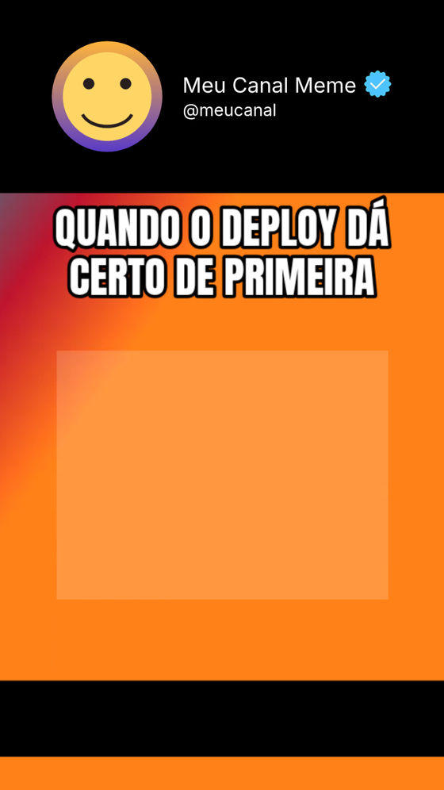
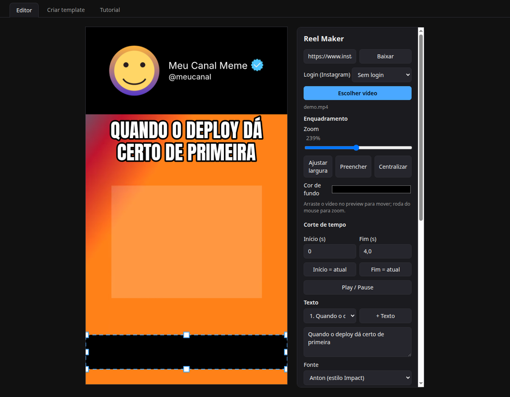
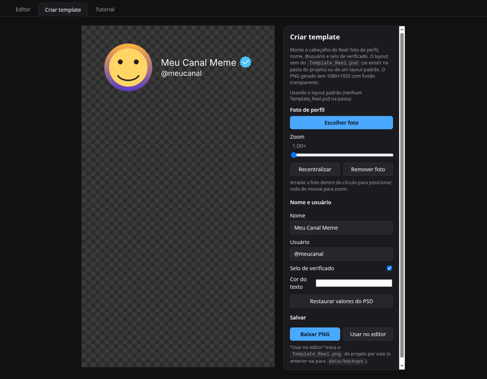
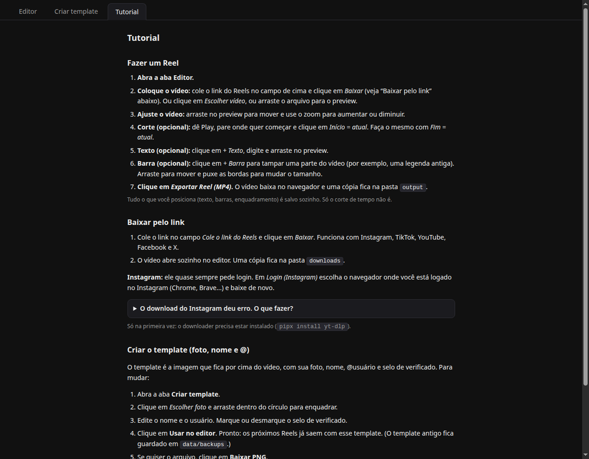

<div align="center">

# 🎬 Meme Reel Maker

**Transforme qualquer vídeo em um Reel 9:16 com template, legendas de meme e barras, direto do navegador.**

Tudo roda **no seu computador**. O vídeo não é enviado para nenhum serviço.


<br>



<sub>Resultado: cabeçalho (template) + vídeo + legenda de meme + barra. O vídeo de exemplo é gerado por computador.</sub>

</div>

---

## ✨ O que ele faz

| | |
| --- | --- |
| 📥 **Baixa pelo link** | Instagram, TikTok, YouTube, Facebook e X, usando o `yt-dlp`. |
| 🎯 **Enquadra em 9:16** | Arrastar, zoom, *Ajustar largura*, *Preencher*, *Centralizar* e cor de fundo. Mira em 1080×1920. |
| ✂️ **Corta o tempo** | Marque início e fim com um clique, no ponto em que o vídeo está. |
| 🔤 **Textos de meme** | Anton, Bebas Neue, Montserrat ExtraBold e Inter Bold, com contorno, cor, tamanho e posição livres. |
| ⬛ **Barras** | Tampe legendas antigas e marcas d'água. Arraste, redimensione pelas alças ou digite X/Y/Largura/Altura. |
| 🖼️ **Template** | Cabeçalho com foto de perfil, nome, @usuário e selo de verificado por cima do vídeo. |
| 🎨 **Criar template** | Aba para montar o seu cabeçalho e baixar o PNG, sem Photoshop. |
| 📤 **Exporta MP4** | H.264 + AAC, 1080×1920, 30 fps, pronto para postar. |
| 💾 **Salva sozinho** | Posições, textos, barras e enquadramento voltam na próxima vez. |

## 📸 Como é

### Editor

Cole o link (ou escolha um arquivo), enquadre, ponha texto e barra, e exporte.



A ordem das camadas na exportação é sempre: **fundo → vídeo → barras → template → texto**. Assim a barra tampa o vídeo, mas nunca o cabeçalho nem as suas legendas.

### Criar template

Escolha a foto, edite o nome e o @usuário, ligue ou desligue o selo e clique em **Usar no editor**. O texto encolhe sozinho se o nome for muito grande.



### Tutorial dentro do programa

<details>
<summary>Ver a aba Tutorial</summary>

<br>



</details>

## 🚀 Instalação

### Requisitos

- [Node.js](https://nodejs.org) 20.15 ou mais novo (recomendado: 22+)
- [ffmpeg](https://ffmpeg.org) no `PATH`
- [yt-dlp](https://github.com/yt-dlp/yt-dlp), só se for baixar vídeos por link

No Ubuntu/Debian:

```bash
sudo apt install ffmpeg pipx
pipx install yt-dlp
```

### Rodando

```bash
git clone https://github.com/dbodbo/meme-reel-maker.git
cd meme-reel-maker
npm install
npm start
```

Abra **http://localhost:3000**.

> Depois de atualizar o código (`git pull`), pare o programa com `Ctrl+C` e rode `npm start` de novo.

## 🧭 Fazendo um Reel

1. Na aba **Editor**, cole o link e clique em **Baixar**, ou use **Escolher vídeo** / arraste um arquivo para o preview.
2. Arraste o vídeo no preview e use o zoom para enquadrar.
3. *(Opcional)* Corte o tempo com **Início = atual** e **Fim = atual**.
4. *(Opcional)* **+ Texto** para legendas e **+ Barra** para tampar partes do vídeo.
5. **Exportar Reel (MP4)**. O arquivo baixa no navegador e uma cópia fica em `output/`.

## 🖼️ Template

O programa já vem com um template padrão (círculo cinza, "Seu Nome", "@seuusuario"). Para usar o seu:

1. Abra a aba **Criar template**.
2. Escolha a foto, edite nome e usuário e marque ou desmarque o selo de verificado.
3. **Usar no editor** salva como `Template_Reel.png` na pasta do projeto, e o editor passa a usar esse arquivo. O anterior fica em `data/backups/`. **Baixar PNG** só baixa o arquivo.

<details>
<summary>Usando um PSD ou um PNG seu</summary>

<br>

- **PSD:** se existir um `Template_Reel.psd` na pasta do projeto, a aba usa as posições, o tamanho e a cor dos textos dele. As camadas precisam se chamar `name`, `user`, `Verificado` e `Profile` (PSD RGB de 8 bits). Sem o PSD, vale o layout de `assets/layout.json`.
- **PNG pronto:** qualquer PNG 1080×1920 com fundo transparente, feito em qualquer editor, serve. Salve como `Template_Reel.png` na pasta do projeto.

`Template_Reel.png` e `Template_Reel.psd` estão no `.gitignore`, então o seu template pessoal não vai para o GitHub.

</details>

## 🔐 Baixando do Instagram (login)

TikTok, YouTube e outros costumam baixar sem login. **O Instagram quase sempre exige.** Em **Login (Instagram)**, escolha o navegador em que você está logado (Chrome, Firefox, Brave, Edge ou Chromium). O `yt-dlp` lê os cookies dele só no seu computador.

<details>
<summary>Deu erro? Veja as soluções</summary>

<br>

| Problema | Solução |
| --- | --- |
| Mensagem sobre `secretstorage` | `pipx inject yt-dlp secretstorage` |
| "Failed to parse JSON" ou resposta vazia | Atualize: `pipx install --force --pip-args="--pre" yt-dlp` e tente depois de alguns minutos |
| O chaveiro do Linux não é encontrado (comum no Chrome/Brave) | Use o `cookies.txt` (abaixo) |

**Usando o `cookies.txt`:** no navegador, com o Instagram aberto e logado, exporte os cookies com uma extensão como "Get cookies.txt LOCALLY" e salve como `cookies.txt` na pasta do projeto. Se o arquivo existir, ele tem prioridade sobre o seletor de login.

</details>

> [!WARNING]
> **O `cookies.txt` dá acesso à sua conta.** Nunca compartilhe, nunca faça commit (ele já está no `.gitignore`) e, se possível, use uma conta secundária. Se vazar, saia da conta no Instagram para invalidar a sessão.

Baixe só conteúdo que você tem direito de usar e respeite os termos de cada plataforma.

## ⚙️ Variáveis de ambiente

| Variável | Para quê |
| --- | --- |
| `PORT` | Porta do servidor (padrão `3000`) |
| `HOST` | Endereço em que escuta (padrão `127.0.0.1`, só a sua máquina) |
| `YTDLP` | Caminho do `yt-dlp`, se não estiver no `PATH` |
| `YTDLP_COOKIES_BROWSER` | Navegador padrão para o login (ex.: `chrome`) |

Exemplo: `PORT=4000 npm start`.

## 🗂️ Estrutura

```
server.js        servidor (Express): configurações, download, render com ffmpeg, template
psd.js           leitor mínimo de PSD usado pela aba "Criar template"
public/          interface (index.html, app.js, template.js, tabs.js, style.css)
assets/          template e layout padrão
docs/            imagens deste README
data/            suas configurações, foto do template e backups (não vai para o Git)
downloads/       vídeos baixados por link (não vai para o Git)
output/          Reels exportados (não vai para o Git)
```

## 🛡️ Segurança

O servidor foi feito para uso **local**. Por padrão ele só aceita conexões da própria máquina, não tem login e executa `ffmpeg` e `yt-dlp` no seu computador. **Não o exponha na internet.**
